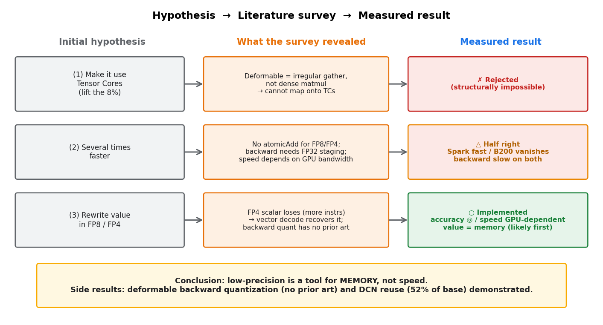
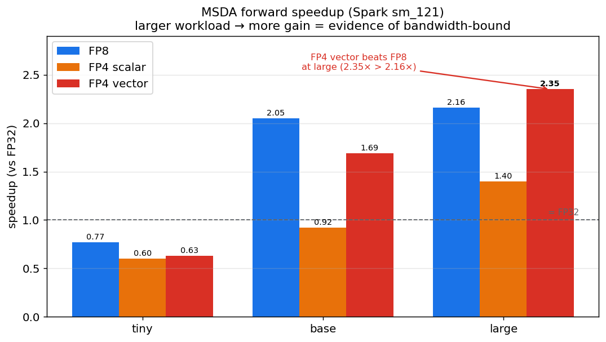
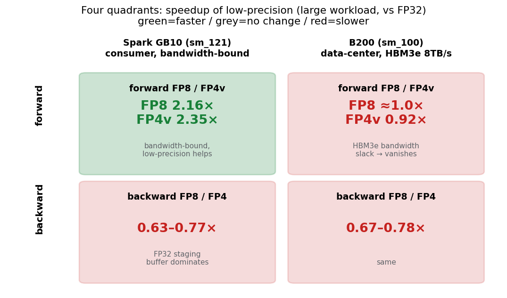
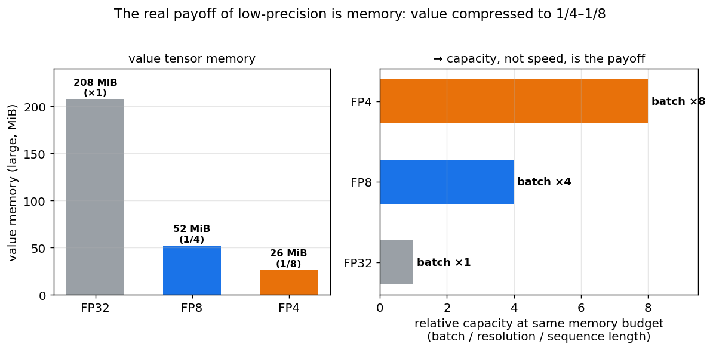

# FP4/FP8 Custom CUDA Kernels for Deformable Attention on NVIDIA Blackwell

**Rewriting BEVFormer's Deformable Attention / Convolution kernels in FP8 (e4m3) and FP4 (e2m1), measured on two Blackwell architectures — consumer GB10 (DGX Spark, sm_121) and data-center B200 (sm_100). The honest one-line result: low-precision helped *memory*, not *speed*.**

- **License**: Apache 2.0
- **Verified on**: DGX Spark GB10 (sm_121) / B200 (sm_100, RunPod)
- **Targets**: `ms_deform_attn` (MSDA) and `modulated_deform_conv` (DCN v2) in mmcv-full 1.7.2
- **Predecessor**: [bevformer-blackwell](https://github.com/nabe2030/bevformer-blackwell) — this repo is the "next step" that one promised

---

This is the sequel to [bevformer-blackwell](https://github.com/nabe2030/bevformer-blackwell). The previous repo showed, with measurements, that putting BEVFormer on the latest GPUs barely speeds up training, because its core Deformable Attention is a sparse gather + bilinear interpolation that Tensor Cores cannot accelerate. It ended with a promise:

> A natural next step would be to **rewrite the Deformable Attention CUDA kernel itself into a form that can use Tensor Cores / FP8.** However, whether that actually makes things faster, and by how much, is **untested.** ... We plan to explore this in a separate repository.

**This repo is that answer.** We wrote the FP8/FP4 kernels and measured them. The short version: speed didn't come, but a clear memory benefit and two results we could not find prior art for did.

---

## What you'll find here

- Which parts of deformable attention can be made low-precision, and which must stay FP32 (the design invariants)
- An implementation story: FP8 forward works cleanly / naive FP4 actually **loses to FP8** / a vector decode recovers it and **beats FP8**
- How to quantize the **backward** pass that scatters gradients in FP8/FP4 (and how the `atomicAdd` type constraint was worked around)
- That the MSDA technique transfers directly to DCN (structural isomorphism, verified by measurement)
- And the central honest result — **on B200, low-precision does not make it faster. Here's why.**

---

## 0. Recap of the predecessor

The previous README, in brief:

- Running BEVFormer-tiny on B200 / H200 barely speeds up training (AMP A/B ratio within ±10%, no generation gap)
- Because the core Deformable Attention is a **sparse gather + bilinear interpolation**, not the dense matrix multiply that Tensor Cores accelerate (TC utilization caps at ~8%, structurally, regardless of GPU generation)
- This is the flip side of Deformable Attention's efficiency — sampling only a few points (sparse) is exactly what makes it incompatible with the dense-only Tensor Core

The previous work left "what if we rewrite the kernel in FP8/FP4?" as an **untested** homework. This repo answers it with custom kernels and measurements.

One new finding from a fresh base profile (not in the previous README): on BEVFormer-base (ResNet-101-DCN backbone), the kernel-time breakdown is **DCN 52.49% / MSDA 10.46% / Tensor Core 6.71%** — the biggest pillar is not MSDA but **DCN (deformable convolution)**. As shown later, DCN is structurally isomorphic to MSDA, so the MSDA technique carries straight over. That is why this work covers both MSDA and DCN.

---

## 1. The original ambition, and how the survey half-broke it

The hypothesis we set out with was simple:

1. Rewrite the dequant + interpolation loop of Deformable Attention in FP8/FP4
2. **Make it use Tensor Cores**, lifting the 8% TC utilization observed before
3. Thereby make BEVFormer training **several times faster**

Before writing any code we ran our standing methodology — *survey NVIDIA docs + GitHub + community several times before trying a new technique*. That survey already broke hypotheses (2) and (3). Here is what it turned up.

### 1.1 What can be low-precision, and what must stay FP32 — the design invariants

Boiled down, deformable attention / deformable convolution does:

1. For each output position, pick a few sampling points on the input feature map (offset / sampling location)
2. At each point, fetch features by **bilinear interpolation (BLI)** (weighted sum of 4 neighbors)
3. Sum them weighted by attention weight (MSDA) / mask (DCN)

The fattest data the GPU reads is the **value (input feature map)**. So we make **only the value tensor** low-precision and leave everything else in FP32:

| Element | Precision | Reason |
|---|---|---|
| **value / input feature** | **FP8 e4m3 / FP4 e2m1** | The quantization target. Largest tensor read from GMEM |
| sampling location / offset | FP32 | Coordinates need precision. FP16 is possible but kept FP32 to isolate error sources |
| attention weight / mask | FP32 | Small values in [0,1], tiny in size |
| BLI accumulator | FP32 | Interpolation and summation in FP32, localizing error to the value quantization |
| output | FP32 | Feeds the downstream matmul / loss |

Two more design choices:

- **Pull the scale's linearity outside the kernel**: the per-tensor quantization scale (FP8 = `max/448`, FP4 = `max/6`) can, because interpolation is linear, be reapplied once at the output via `output.mul_(scale)` instead of inside the kernel
- **Do not touch mmcv's dispatcher**: mmcv's `AT_DISPATCH_FLOATING_TYPES_AND_HALF` only expands float/double/half (it never reaches FP8/FP4). Rather than patch it, we write the FP8/FP4 kernels as a separate cpp_extension

### 1.2 There is no atomicAdd for FP8/FP4 (this constrains the backward design)

In the backward pass, `atomicAdd` into `grad_value` dominates. Grepping CUDA 13.0's `cuda_fp8.h` (496 lines) and `cuda_fp4.h` for `atomicAdd` returns **zero hits in both** — there is no FP8/FP4 atomicAdd overload (in contrast, `cuda_fp16.h` L4458/4477 has `__half`/`__half2` atomicAdd, and `cuda_bf16.h` L4272/4292 has the bf16 ones). A hand-rolled CAS loop is impractical too, since atomicCAS works on a 32-bit minimum unit, which packs 4 FP8 or 8 FP4 values per RMW. **So writing gradients directly in FP8/FP4 does not even compile; the only realistic option is to stage grad_value in an FP32 buffer.** This was settled, from source evidence, before fixing the design (see `docs/KERNEL_ANALYSIS_B_BACKWARD_PRECISION.md`).

### 1.3 The deformable backward atomic is order-nondeterministic

Reading mmcv's `ms_deform_attn_col2im_bilinear` and `dcn_v2_cuda_kernel.cuh`, both have **multiple threads atomicAdd into the same value position**, so the result is order-nondeterministic. The DCNv2 official README itself notes "Backward is not reentrant. gradcheck typically requires double precision," so larger numerical drift in a quantized backward was a known risk.

### 1.4 The state of the art in attention quantization is all dense

Surveying prior work on quantized attention training (SageBwd / INT8, Attn-QAT / FP4, FPSAttention, and others) several times, all of it is **dense attention** (quantizing the Q×Kᵀ and Softmax of Transformers). We found no prior art for quantizing a **gather + interpolation + scatter-atomic backward**.

### 1.5 FP64 / Rubin are not the answer (considered and dropped)

We considered "maybe FP32 staging isn't precise enough; use FP64 or Rubin's new features." Both turned out to be poor fits:

- **FP64 atomicAdd is built-in on sm_60+, but is slower than FP32 for scattered writes** (atomic latency and double the HBM traffic). "More precision, less speed" — the wrong direction
- **Rubin's FP64 pitch is about Tensor-Core emulation for HPC GEMM** (cuBLAS ADP, 1.5–3×), irrelevant to irregular atomics
- Conclusion: **FP32 staging is not a compromise ceiling but the sweet spot**. FP8/FP4 (no atomic) and FP64 (slow) are both poor; FP32 sits in the middle

### 1.6 How the hypothesis was rewritten

The survey made clear that Deformable Attention is fundamentally **indirect gather + interpolation + scatter atomic**, with no current path to reshape it into the dense matmul form Tensor Cores require (sparse-matmul reshaping is a future direction, out of scope here). The remaining testable hypothesis was (1) "rewrite the value load in FP8/FP4" — a pure memory-bound improvement whose speed effect depends on workload scale. We went and measured it.

---

## 2. Stage 1: MSDA forward — everything we tried (including the failure)

### 2-A. FP8 (e4m3) — works cleanly

Load value in FP8 e4m3, `static_cast<float>` to dequant right before BLI, interpolate and accumulate in FP32. For a fair comparison the baseline is a **byte-for-byte twin kernel** with value in FP32 (`ms_deform_attn_fp8_kernel.cu`, ~220 LOC, built with `cpp_extension.load` on Spark sm_121).

| workload | value MiB | FP32 ms | FP8 ms | speedup |
|---|---:|---:|---:|---:|
| tiny (bs=2, q=100, h=8, c=32, L=1, P=8) | 4.88 | 0.0118 | 0.0153 | **0.77×** (slower) |
| base (bs=2, q=900, h=8, c=64, L=4, P=4) | 51.93 | 0.2666 | 0.1302 | **2.05×** |
| large (bs=2, q=2500, h=8, c=64, L=4, P=4) | 207.52 | 1.2777 | 0.5908 | **2.16×** |

- **Accuracy**: normalized abs error (mean|diff| / mean|ref|) = **2.55%** (pass < 5%, as expected for FP8 e4m3)

The slowdown at tiny is because the value is small, fits in L2, and the kernel-launch + `mul_` overhead outweighs the memory saving. At base/large the workload becomes HBM-bound and the memory halving (effective byte ratio ~2.66×, since location/weight/output stay FP32, so not the theoretical 4×) translates directly into speedup. The measured ~2× sits within that range. **The larger the workload, the more it helps — evidence of bandwidth-bound behavior.** At this stage everything was "as expected."

### 2-B. FP4 (e2m1) scalar — honestly, it failed

Next, FP4 e2m1 (2 values packed per byte; PyTorch's `float4_e2m1fn_x2` is declaration-only, so uint8 storage + a custom quantize/pack kernel), written naively as "1 thread = 1 channel" (`ms_deform_attn_fp4_kernel.cu`). **It lost to FP8:**

| workload | speedup (vs FP32) | vs FP8 |
|---|---:|---:|
| tiny | 0.60× | 0.76× |
| base | 0.92× | 0.45× |
| large | 1.40× | 0.65× |

- **Accuracy**: 13.88% (about 5.4× worse than FP8, but passes < 20%)

The cause was clear:

- It reads a byte (2 values) but uses only one nibble (the neighboring thread fetches the other nibble of the same byte)
- Selecting the even/odd nibble causes **warp divergence**
- Dequant for FP4 takes more steps (`fp4x2 → half2 → __half → float`); per BLI (4 neighbors) FP8 is **4 instructions vs FP4's 12–16**

The instruction-count increase ate the memory halving (vs FP8) = it became compute-bound. This matches the conclusion the LLM GEMM quantization community already reached (NVIDIA Marlin, vLLM's FP4 GEMM papers/issues): **a scalar implementation loses no matter who writes it.** The normal move here is to give up, but the next phase brought it back.

> An honest failure — but **being able to explain the loss by instruction count** is what led to the recovery.

### 2-C. FP4 vector decode — beats FP8 (no public prior art found)

We fixed the scalar loss ("one value at a time, with branching") with the **vector decode** used in LLM GEMM quantization: **1 thread = 2 channels**, expanding two nibbles into a half2 with `__nv_cvt_fp4x2_to_halfraw2`, **branch-free**. Half the launched kernels, ~6 dequant instructions per BLI (`ms_deform_attn_fp4v_kernel.cu`).

| workload | FP4v ms | vs FP32 | vs FP8 | vs FP4 scalar |
|---|---:|---:|---:|---:|
| tiny | 0.0187 | 0.63× | 0.81× | 1.06× |
| base | 0.1569 | 1.69× | 0.83× | 1.85× |
| large | 0.5429 | **2.35×** | **1.10×** | 1.68× |

- **Bit-identical** to the scalar version (semantics unchanged, same 13.88% accuracy)
- At large, **2.35× = beats FP8's 2.16× (1.10× over FP8)**

That it wins over FP8 only at large also makes sense in bandwidth terms: at large the value exceeds cache and becomes HBM-bound, so the memory halving (vs FP8) dominates and the dequant instructions hide behind HBM latency. At base/tiny, which fit in cache, FP8's lower instruction count wins.

> **In public research, we found no example of applying vector-decode FP4 to a deformable gather + bilinear interpolation and beating FP8** (see §6, prior-art search converged to zero). FP4 dense attention (FlashAttention family) exists, but that is matrix multiply, a different beast from this irregular gather.

---

## 3. Stage 1-C: quantizing the backward — getting past the `atomicAdd` type constraint

A working forward is not enough; **training** needs the backward. Here is the deformable-specific wall.

The backward **scatters** gradients from each sampling point back into the input. Multiple threads write to the same input position, so **`atomicAdd` is mandatory** (128 per thread for MSDA base). But as §1.2 showed, there is no atomicAdd for FP8/FP4.

**Solution**: load value in FP8/FP4 and dequant on the fly, but **accumulate gradients in an FP32 staging buffer with the hardware float `atomicAdd`**. grad_sampling_loc / grad_attn_weight are FP32 too. This mirrors NVIDIA Transformer Engine's FP8 backward (low-precision storage, FP32 accumulator). The verification reference is an independent FP32 port of mmcv's own backward (`ms_deform_attn_fp32_backward_kernel.cu` + `msda_fp32_ref.py`, ~310 LOC total).

**Accuracy (vs mmcv FP32 backward, Spark sm_121):**

| term | FP8 backward | FP4 backward |
|---|---:|---:|
| output | 2.55% | 13.88% |
| grad_value | 2.56% | 13.86% |
| grad_sampling_loc | 2.50% | 11.72% |
| grad_attn_weight | 2.00% | 9.81% |

The forward quantization error propagates into the gradients without blowing up. **Quantizing a deformable backward and matching mmcv's own — we found no public prior art for this.**

**Speed did not come (honestly)** — forward+backward wall time (Spark sm_121):

| workload | FP32 ms | FP8 ms | FP4 ms | spFP8 | spFP4 |
|---|---:|---:|---:|---:|---:|
| tiny | 0.322 | 0.514 | 0.463 | 0.627× | 0.695× |
| base | 4.570 | 6.452 | 5.983 | 0.708× | 0.764× |
| large | 15.483 | 21.860 | 20.102 | 0.708× | 0.770× |

The per-iteration zeroing of the FP32 staging buffer, the per-iteration quantize, and the gradient compute / atomic writes dominate, exceeding the value-memory saving, so both precisions are slower than FP32. FP4 edges out FP8 (1.08–1.11×) only because its value memory is halved again.

> **Pitfall note**: a one-time 88× gradient error came from forgetting to reapply `scale` to grad_sampling_loc / grad_attn_weight (STE cancels it only for grad_value; the other two need the output scale reapplied). Because the reference was initially the autograd `F.grid_sample`, this 88× was misdiagnosed for 30 minutes as a "convention gap between ref and the mmcv kernel." Switching the reference to an independent port of mmcv's own backward made it clear the drift was a missing scale in the FP8 path. Also, `cpp_extension`'s `load(name=)` must differ from the wrapper's `.py` module name, or the import breaks on py3.11. Once these were turned into a checklist, the FP4 backward passed on the first try.

---

## 4. Stage 2: porting to DCN — structural isomorphism, verified by measurement

The biggest pillar of the base profile was DCN (52.49%). Reading the DCN v2 (`modulated_deform_conv`) CUDA kernel shows it is **structurally isomorphic** to MSDA (both descend from the Microsoft DCN Caffe port):

| Item | MSDA | DCN v2 | |
|---|---|---|---|
| BLI helper | `ms_deform_attn_im2col_bilinear` | `dmcn_im2col_bilinear` | **logic identical** |
| forward thread mapping | 1 output element | 1 output element | isomorphic |
| weighting | attention weight (∈[0,1], Σ=1) | mask (∈[0,1], sigmoid) | isomorphic |
| backward atomicAdd | many | **one** (grad_im only) | DCN is simpler |
| dispatcher | `AT_DISPATCH_FLOATING_TYPES_AND_HALF` | same | same wall |

This predicts "MSDA 1-A (FP8 forward) ports directly to DCN." Verified by measurement (`dcn_v2_fp8_kernel.cu`, ~330 LOC):

- **DCN forward FP8 (B200, sm_100)**: normalized abs error = **2.63%** (vs mmcv FP32 DCN, pass < 5%)
- This **reproduces MSDA 1-A's 2.55%** — the isomorphism prediction is confirmed by measurement, and "the MSDA low-precision technique ports to DCN" is demonstrated. This opens the path to attack the **52% DCN pillar** of the base profile with low-precision (verification cost: $0.22)

But the **DCN speed story is the same as MSDA's**. Sweeping mmcv FP32 DCN workloads on B200:

- Every config fits in B200's L2 cache (~126 MB) (input features 0.4–58.6 MB)
- Peak achieved bandwidth is **251 GB/s = ~3% of HBM's effective peak** — bandwidth is nowhere near saturated
- → DCN is **latency-bound** on irregular gather, not memory-bandwidth-bound
- → **on B200, shrinking value to FP8/FP4 does not yield speed** (fully consistent with MSDA)

(FP8/FP4 for the DCN backward should be easy to port — only one atomicAdd, simpler than MSDA — and is confirmed by design. Implementation/measurement is pending. What we can say is "measured" here is DCN forward FP8.)

---

## 5. The four-quadrant conclusion — speed is GPU-generation-dependent, the value is memory

Lay out the four quadrants of forward / backward × consumer (Spark GB10) / data-center (B200):

| | Spark GB10 (sm_121, bandwidth-bound) | B200 (sm_100, HBM3e 8 TB/s) |
|---|---|---|
| **forward FP8** | large 2.16× (fast) | large FP32 = FP8 (effect gone) |
| **forward FP4v** | large 2.35× (beats FP8) | large 0.92× (slower) |
| **backward FP8/FP4** | slower than FP32 (0.63–0.77×) | slower than FP32 (0.67–0.78×) |

**Why speed vanishes on B200**: HBM3e's 8 TB/s is fast enough that even large's 208 MiB of value does not saturate the bandwidth. Without a bandwidth bottleneck, shrinking the dtype from 4 bytes to 1 leaves kernel time unchanged, and FP4's dequant overhead becomes visible and even slows it down. On top of that, Tensor Cores are effectively unavailable on consumer Blackwell sm_121, and deformable's irregular gather can't use TCs anyway.

So **the real value of low-precision is memory, not speed.** Value in FP8 is 1/4 of FP32, FP4 is 1/8. That means **4–8× larger batch / longer temporal queue / higher resolution** in the same memory. When speed isn't the bottleneck, capacity is where low-precision pays off — that is the honest conclusion after measuring all four quadrants.

> The previous README showed "even the latest GPU isn't much faster"; this one shows "even low-precision isn't faster (on B200)." Same root: **Deformable Attention is bound neither by compute nor bandwidth but by the latency of irregular memory access.**

(Note: we treat Spark GB10's L2/SLC as ~40 MB for the qualitative "does the value fit in cache / where does it become HBM-bound" discussion, but this is an estimate, not confirmed against NVIDIA's published specs.)

---

## 6. Novelty — what is "first," and what is not (honestly)

To avoid overclaiming, here is the result of the prior-art search (NVIDIA docs + GitHub + papers, several passes to convergence), as-is.

**No public prior art found (= likely novel):**

- Applying vector-decode FP4 to a **deformable gather + bilinear interpolation** and beating FP8
- Quantizing a **deformable backward (gather + scatter)** — matching mmcv's own via FP32 staging
- Comparing the **same kernel across sm_100 (B200) and sm_121 (DGX Spark)**, which are different microarchitectures with no binary compatibility

**Has prior art, not our originality (= incremental):**

- "Making ms_deform_attn faster" alone — TensorRT FP16/INT8 plugins (inference-only), TVM optimizations, etc. exist
- FP4 dense attention (FlashAttention family) — but that is matrix multiply, a separate lineage

**Disclaimer**: the above is the scope of **public** research. We cannot rule out that NVIDIA or autonomous-driving companies have equivalents in **internal, unpublished** work. We state it as "no prior art in public research; existence of internal work unknown."

---

## 7. Implications for GPU investment (continuing from the predecessor)

The previous repo concluded "to just run BEVFormer-tiny, performance is close, so pick the GPU by cost efficiency." This adds practical guidance for anyone considering low-precision:

- **If you expect "speed" from low-precision on deformable ops, pick the GPU carefully.** On bandwidth-bound consumer parts (e.g. GB10) FP8/FP4 helps (2.1–2.4× at large). On HBM3e data-center parts (B200), it may not help — at least not the way a spec sheet would suggest
- **If you want to reduce memory, it helps regardless of GPU.** value FP8 = 1/4, FP4 = 1/8. Low-precision shines exactly when capacity limits your batch or resolution
- **Low-precision in the backward (= training) currently hurts speed.** The staging-buffer cost dominates, so it is realistic only as a memory measure
- As a general rule, **evaluate "model + kernel + GPU" together.** A spec-sheet comparison alone misleads the ROI estimate

---

## 8. Honest notes on publication

For research integrity, two judgments to state explicitly.

### 8.1 The B200 speed of the FP4 backward was not measured

Of the four quadrants (forward / backward × Spark / B200), we did not measure **FP4 backward × B200**, for five reasons:

1. The speed claim is complete with FP8's four quadrants (FP8 backward B200 negative + the forward quadrants)
2. Backward speed is dominated by factors independent of value bit width (staging-buffer zeroing / atomics / re-dequant); the bit-width difference shrinks further on B200's HBM3e
3. On Spark, FP4 / FP8 = 1.08–1.11× (FP4 slightly faster); on B200, FP8 = 0.67–0.78× negative → FP4 is structurally predicted to be negative on the same order
4. The value of measuring FP4 is correctness, not speed (reproducing mmcv FP32 at ~14% with 4-bit = proof at the deepest point of memory reduction), which is already shown by the Spark gradcheck

### 8.2 On the choice of verification reference

As noted in §3, initially using the autograd `F.grid_sample` as the reference caused a 30-minute detour in backward debugging. We switched to an independent port of mmcv's own backward. **For a study about "FP8-ifying the mmcv kernel," the verification reference should be mmcv's own backward** — the two are mathematically equivalent, but the debugging paths differ greatly.

---

## 9. Reproduction (planned)

- **MSDA / DCN kernel sources**: this repo's `src/` (FP32 twin / FP8 / FP4 scalar / FP4 vector / backward / DCN FP8, each with wrapper + numerical check + microbench)
- **Build**: auto-detect arch from device capability (`_arch_cflags.py`, Spark → sm_121 / B200 → sm_100). Standalone kernels build on the fly with `cpp_extension.load`. The BEVFormer-inclusive verification builds on u58 with docker (in-image nvcc compiles for sm_100) → Docker Hub push → RunPod pulls and runs (no compilation during billed time)
- **Verification reference is mmcv's own FP32 kernel**. Using autograd / grid_sample as the reference mixes "quantization error" with "reference-implementation definition differences" (a lesson learned the hard way)

(Concrete commands to be added at release.)

---

## 10. Related work and references

- Predecessor: BEVFormer on NVIDIA Blackwell B200 / Hopper H200 (github.com/nabe2030/bevformer-blackwell)
- BEVFormer (ECCV 2022): https://arxiv.org/abs/2203.17270
- Deformable ConvNets v2 (Zhu et al., CVPR 2019): https://arxiv.org/abs/1811.11168
- OpenMMLab / mmcv (home of the deformable kernels): https://github.com/open-mmlab/mmcv
- NVIDIA Marlin (FP4 GEMM dequant technique): https://github.com/IST-DASLab/marlin
- NVIDIA Transformer Engine (source of the FP8-backward idea): https://github.com/NVIDIA/TransformerEngine
- Flash Attention (precedent for putting sparse attention on Tensor Cores): https://arxiv.org/abs/2205.14135

---

## Appendix: key numbers at a glance

| Stage | Content | Accuracy (norm. abs err) | Speed (Spark sm_121, large, vs FP32) | B200 (large) |
|---|---|---|---|---|
| 1-A | MSDA forward FP8 | 2.55% | 2.16× | effect gone (FP32 ≈ FP8) |
| 1-B | MSDA forward FP4 scalar | 13.88% | 1.40× (vs FP8 0.65× = loses) | — |
| 1-B' | MSDA forward FP4 vector | 13.88% | **2.35× (vs FP8 1.10× = wins)** | 0.92× (loses) |
| 1-C-a | MSDA backward FP8 | grad 2.0–2.56% | 0.71× (slower than FP32) | 0.67–0.78× (slower) |
| 1-C-b | MSDA backward FP4 | grad 9.81–13.88% | 0.77× (slower than FP32) | not measured (§8.1) |
| 2-1 | DCN forward FP8 | **2.63% (reproduces MSDA)** | not measured | cache-fit / latency-bound → no speed effect |

> Note: Spark speed figures are for workloads tiny/base/large, bs=2. All to be finalized with reproduction commands at release. Spark's L2/SLC ~40 MB is an estimate.

### Key commits

- `2d0b72b` Stage 1-C-a: FP8 backward kernel + FP32 reference + full numerical PASS
- `e1d0f73` Stage 1-C-4 Spark microbench: FP8 backward slower than FP32 (correctness ✓ speed ✗)
- `8453c64` Stage 1-C-4 B200 microbench: negative speedup confirmed, 4-quadrant complete
- `f5d177e` Stage 1-C-b: FP4 backward complete, 1-shot success
- `068cce1` HANDOFF/OPERATIONS_NOTES/LEARNINGS handoff consolidation

## License

Apache License 2.0 (see [LICENSE](LICENSE)). This repository contains derivative work based on BEVFormer (fundamental-vision/BEVFormer) and mmcv / mmdet3d (open-mmlab), each under Apache 2.0; their original copyright and license terms apply.

## Acknowledgments

- The BEVFormer / mmcv / mmdet3d / OpenMMLab teams
- The authors of NVIDIA Marlin / Transformer Engine
- Those who made DGX Spark and RunPod B200 / H200 accessible
- Anthropic Claude Code (Opus 4.7) was used for the survey, implementation, debugging, and documentation
